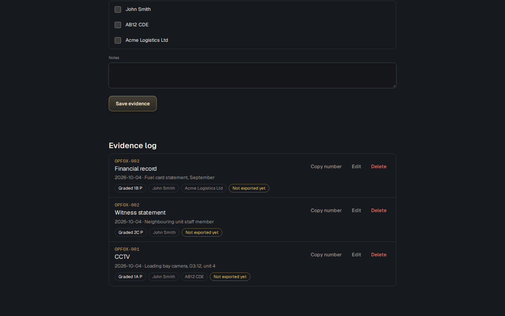

# Case File

**One case, built over time, linked the way you link it.**

**Open it here:** [adriaanbosch.net/case-file](https://adriaanbosch.net/case-file/case-file.html)

No install, no account, no subscription. Click the link and it runs in your browser. adriaanbosch.net hands you the tool; it never sees what you put into it. Everything stays in your browser, on your device.



---

## The problem it was built for

A case rarely arrives in one sitting. A subject turns up in week one, a piece of CCTV in week three, a witness statement a month later. By the time it matters, the case is spread across notes, emails and whatever the evidence files happened to be called. Nothing holds it together.

This tool is where the case lives while it is built: who is involved, what evidence there is and how far it can be trusted, and what happened when. It then hands the links to Obsidian, which draws the picture.

## Who it is for

Anyone building a case over time. Physical security, cyber, corporate fraud, internal theft: the structure stays the same, only what goes in the fields changes.

## What it will not do

**It does not hold the evidence.** The CCTV clip, the document, the photograph all stay where they are. The tool gives each one a number to carry instead.

**It does not draw the link chart.** Obsidian's graph view already does that well, so the tool feeds it rather than copying it.

**It does not grade for you.** How far a source and a piece of information can be trusted is the investigator's call. The tool gives that call a standard scale.

---

## How it works

### Four parts

**Case** holds a name, a reference and a summary. **Subjects** are anything worth tracking: a person, a vehicle, a company, an account, a device, a place. **Evidence** is graded on the UK 3x5x2 model and records what it actually confirmed. **Timeline** ties dates to the subjects and evidence that show them.

### Evidence numbers

Saving a piece of evidence gives it a number built from the case reference, such as `OPFOX-003`. Put that number on the real file or folder. That is the whole link between the tool and the evidence, and it works without the tool knowing where the file lives. **Copy number** puts it on the clipboard for renaming. A deleted entry's number is never given out again.

### Graded the UK way: 3x5x2

Every piece of evidence is graded on the model UK police have used since 2016, set out in the College of Policing guidance on intelligence management:

- **Source evaluation:** 1 reliable, 2 untested, 3 not reliable.
- **Intelligence assessment:** A known directly to the source, B known indirectly but corroborated, C known indirectly, D not known, E suspected to be false or malicious.
- **Handling code:** P where sharing is permitted, C where it is permitted only on conditions, which are recorded with the entry.

The source and the information are graded apart. A reliable source can still pass on something it only heard second-hand, so a CCTV still from the site's own system and a neighbour's account of the same night carry different grades, and the log shows which is which.

Nothing is pre-selected. Every entry is graded on purpose, and the tool won't save one that isn't.

"What was confirmed" is free text on purpose. For a vehicle it might be colour, make and plate. For a login it might be the account, the IP address and the time.

### A file hash, if you have one

Each evidence entry can carry the file's hash from the [File Integrity Check](https://adriaanbosch.net/file-integrity-check/file-integrity-check.html). It travels into the print record and the Obsidian note, so the file can be checked later against what was logged.

### Export to Obsidian

Each subject, evidence entry and event becomes its own Markdown note. The details sit in the front matter, and `[[links]]` join the people, evidence and events that belong together. Unzip the download into your vault and the graph view becomes the link chart.

**Export never overwrites by surprise.** Each entry goes to the vault once. Export again next month and only the new ones go. An entry edited after it was exported is marked "Changed since export" and stays out of the next export unless the box to send it is ticked.

**A note keeps its file name for good.** Rename a subject or the case after exporting and the links still reach the same note, showing the new name. A new entry never takes a file name already used in the vault, even one deleted from the case since. The saved file carries this record, along with every evidence number ever given out.

**Opening an older copy is caught.** If the browser has seen a newer version of the same case, the tool says so before opening, lists any evidence numbers missing from the file, and keeps those numbers retired so none is given out twice.

### Print

**Print** produces the case on paper: the case details, the evidence log with numbers, grades and hashes, the subjects and the timeline.

---

## Getting started

1. Open [the tool](https://adriaanbosch.net/case-file/case-file.html). There is nothing to install.
2. On **Case**, give it a name and a short reference. Set the reference before logging evidence; it starts every evidence number.
3. Add **Subjects** as they come up. Each name has to be different, because it becomes a note title.
4. Log **Evidence** as it arrives, grade it, and put its number on the real file.
5. Add **Timeline** events as the picture builds.
6. Press **Save a copy** from time to time. That file is the record.
7. When ready, open **Export to Obsidian**, press the button and unzip the result into your vault. Then press **Save a copy** again, so the file records what was sent.

The header says when the case has changed since it was last saved to a file.

**Want to check it never sends your data anywhere?** Once the page has opened, switch off your Wi-Fi and carry on. It still saves, prints and exports, because nothing in it needs the website to handle what you type.

---

## Your data

**The saved file is the record. The browser is a cache.**

What you enter is kept in the browser you used, on the device you used. A private window forgets it when you close it, and clearing your browser's data for adriaanbosch.net clears it too.

**Save a copy** gives you a file with the whole case, and **Open** brings it back. Opening a file says what it read: how many subjects, evidence entries and events, anything left out and why, and anything it had to change, such as two subjects with the same name. A file from a different tool, or one far larger than a case file could be, is refused, and nothing is changed.

The browser holds one case at a time. With the tool open in two tabs, each takes up the other's changes before making its own, so the same evidence number is never given out twice. If another tab changes the case while a question such as "Delete this subject?" is on screen, the tool does nothing and asks you to check and try again.

## Privacy, and how to check it rather than trust it

There are no network calls of any kind. No analytics, no telemetry, no sync, no sign-in. The two typefaces, Fraunces and Source Sans 3, are carried inside the page itself, so nothing is fetched to show them.

You do not have to take that on faith. With the tool open, right-click the page, choose **View Page Source**, and search for these three:

```
fetch(          XMLHttpRequest          WebSocket
```

Those are the ways a web page asks the internet for something. There are none of them in here.

Search for `http` as well and you will find one: the **More tools** link to adriaanbosch.net, which only goes anywhere if you click it.

---

## Requirements

A browser, and a connection to open the page. Once it is open it keeps working without one. It works on a phone, and is easiest on a laptop or desktop.

## Credit

The grading follows the 3x5x2 model in the College of Policing's guidance on intelligence management. The tool is written in its own words.

The export is built for [Obsidian](https://obsidian.md), a free note-taking app that keeps its files on your own device. Case File is not made or endorsed by Obsidian.

Fraunces and Source Sans 3 are used under the SIL Open Font Licence.

## More tools

Case File is one of a set of security tools that work the same way. [See the others](https://adriaanbosch.net/#tools).

## Licence

MIT, in `LICENSE`. The page carries the Geist and Geist Mono fonts inside it, under the SIL Open Font Licence, in `OFL-Geist.txt`.
